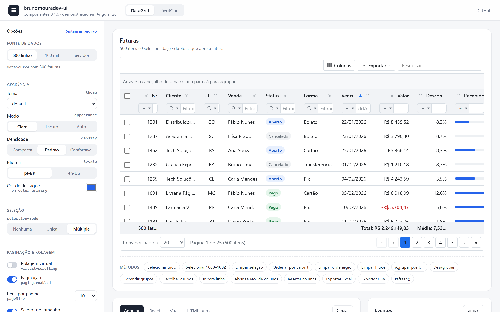
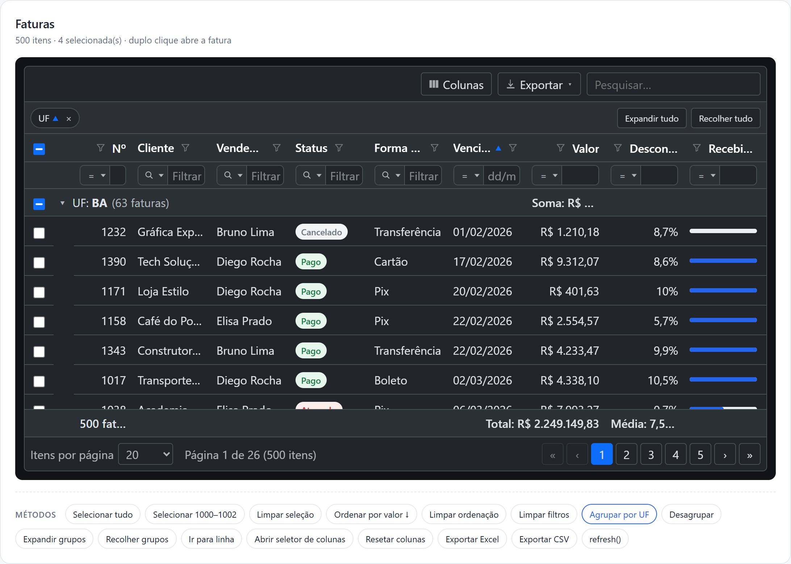
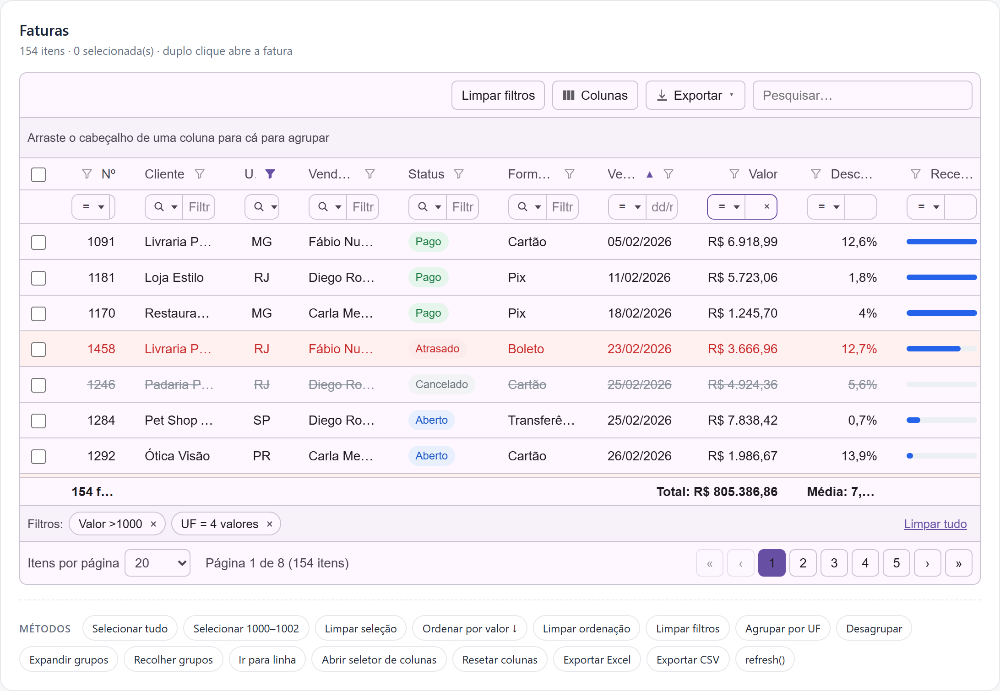
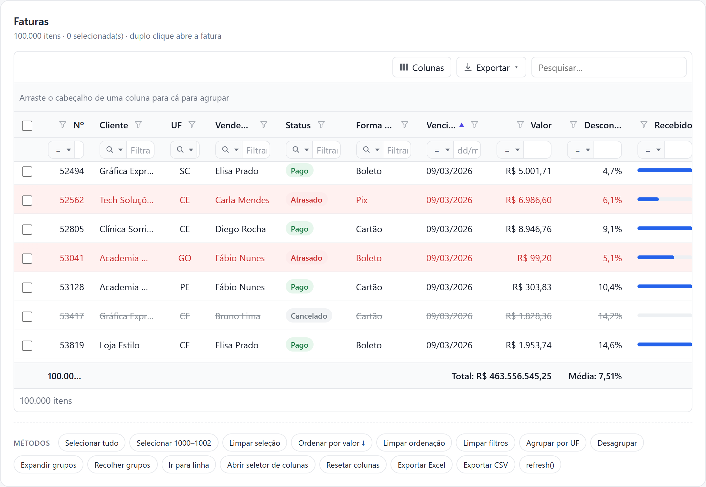
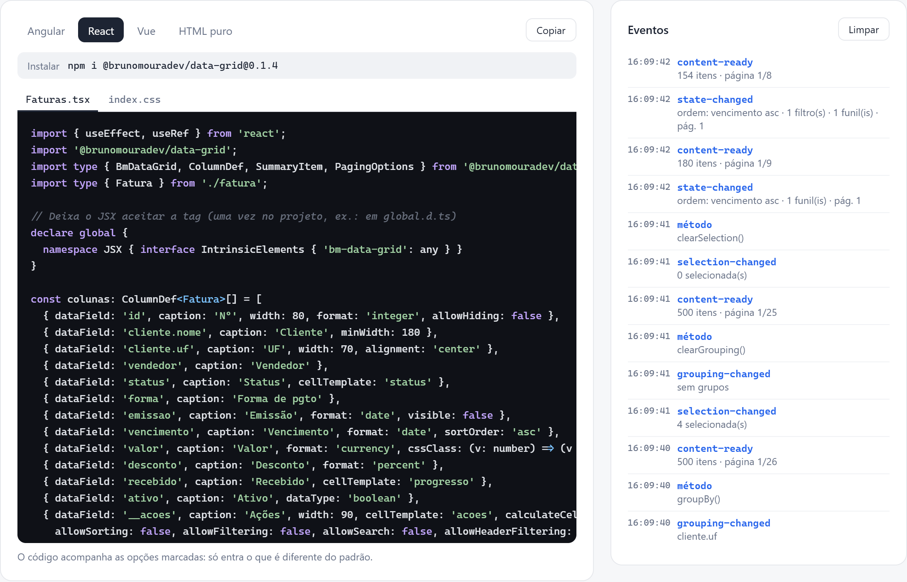

# DataGrid · Protótipo

Protótipo em **Angular 20** do [`@brunomouradev/data-grid`](https://www.npmjs.com/package/@brunomouradev/data-grid)
([código da biblioteca](https://github.com/antoniobrunomourateixeira/brunomouradev-ui)).

Todas as opções da grid ficam num painel lateral, os métodos em botões e os eventos num log ao vivo.
O código equivalente em **Angular, React, Vue e HTML puro** é gerado conforme as opções marcadas.

**▶ Ver rodando:** https://antoniobrunomourateixeira.github.io/datagrid-prototipo/



## Prints

**Bootstrap 5 escuro, agrupado por UF, com seleção múltipla e totais por grupo**



**Material compacto: funil no cabeçalho, linha de filtro, barra de filtros ativos embaixo da tabela (cada filtro com × para remover), regras de linha (`rowClass` / `rowStyle`) e célula por função (`cellRender`)**



**100 mil linhas com rolagem virtual**



**Código gerado (Angular, React, Vue, HTML puro) e log de eventos**



## O que dá para testar

- **Dados:** 500 linhas, 100 mil linhas (rolagem virtual) ou servidor simulado (`remoteData`)
- **Aparência:** tema (`default`, `bootstrap4`, `bootstrap5`, `tailwind`, `material`), claro/escuro/auto, densidade, idioma e cor de destaque
- **Filtro e busca:** linha de filtro, funil no cabeçalho, busca global, barra de filtros ativos embaixo da tabela (`show-filter-panel`) e filtros iniciais (`filterValue`, `selectedFilterOperation`, `filterValues`, `filterType`)
- **Colunas:** seletor, arrastar, redimensionar, largura pelo conteúdo, coluna fixa, coluna opcional
- **Seleção:** nenhuma, única ou múltipla
- **Paginação:** tamanho da página, seletor de tamanho, info
- **Agrupamento:** painel de grupos, agrupar ao abrir, expandir/recolher, totais por grupo
- **Totais e regras:** totais no rodapé, `rowClass`, `rowStyle`, `cssClass`, templates de célula (`bmCellTemplate`) e `cellRender` + `cellStyles`
- **Exportação:** Excel e CSV, nome do arquivo e da aba (`export-sheet-name`)
- **Estado e textos:** `stateStoring` (localStorage), `messages` (textos personalizados), `loading` e texto de "sem dados"
- **Servidor:** `remoteData` e `remoteHeaderFilter` (valores do funil vindos do servidor)
- **Teclado:** setas, Enter (`row-enter`), espaço seleciona, Ctrl+A, Ctrl+C copia para o Excel (`copy-rows`)
- **Métodos:** `selectAll`, `selectRows`, `sortBy`, `groupBy`, `expandAll`, `navigateToRow`, `exportToExcel`, `resetColumnLayout`…

## Rodar

Precisa do Node 20.19 ou superior (exigência do Angular 20):

```bash
nvm use 20.19.0
npm install
npm start
```

Abra http://localhost:4200.

## Arquivos

| Arquivo | O que tem |
|---|---|
| `src/app/app.ts` / `app.html` | tela, ligação das opções com a grid, métodos e eventos |
| `src/app/opcoes.ts` | todas as opções do painel e os valores iniciais |
| `src/app/gerador-codigo.ts` | gera o código de exemplo para cada framework |
| `src/app/bm-cell-template.directive.ts` | diretiva `bmCellTemplate` (templates de célula do Angular) |
| `src/app/data.ts` | faturas fictícias (500 ou 100 mil linhas) |
| `src/styles.scss` | CSS das regras de linha/célula via `::part()` |

O modo "Servidor" simula um back-end com o motor da própria lib (`@brunomouradev/data-grid/engine`).

## Links

- Online (GitHub Pages): https://antoniobrunomourateixeira.github.io/datagrid-prototipo/
- Biblioteca: https://github.com/antoniobrunomourateixeira/brunomouradev-ui
- npm: https://www.npmjs.com/package/@brunomouradev/data-grid
