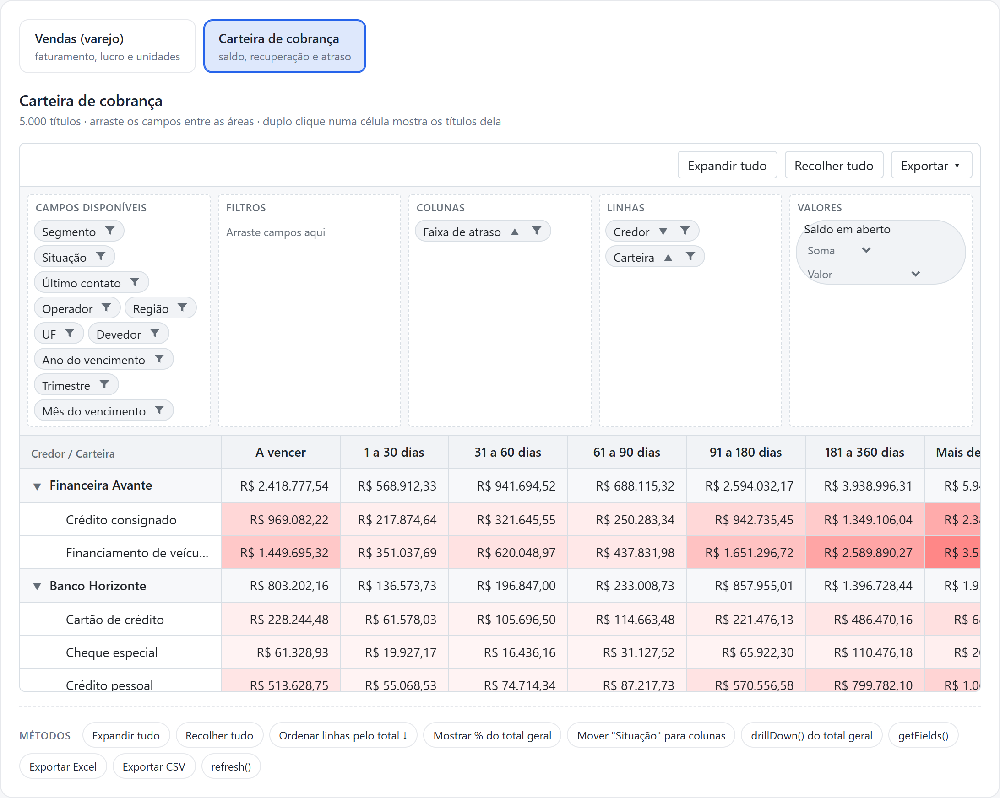
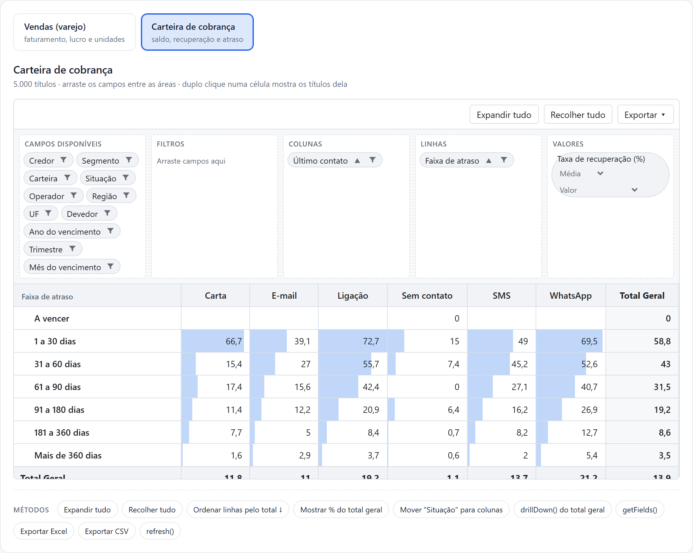

# brunomouradev-ui · Demonstração

Demonstração em **Angular 20** dos componentes da [brunomouradev-ui](https://github.com/antoniobrunomourateixeira/brunomouradev-ui):
[`@brunomouradev/data-grid`](https://www.npmjs.com/package/@brunomouradev/data-grid) e
[`@brunomouradev/pivot-grid`](https://www.npmjs.com/package/@brunomouradev/pivot-grid).

Cada componente tem uma página com todas as opções num painel lateral, os métodos em botões e os eventos num log ao vivo.
O código equivalente em **Angular, React, Vue e HTML puro** é gerado conforme as opções marcadas.

**▶ Ver rodando:** https://antoniobrunomourateixeira.github.io/brunomouradev-ui-demo/

| Página | Endereço |
|---|---|
| DataGrid | https://antoniobrunomourateixeira.github.io/brunomouradev-ui-demo/#/datagrid |
| PivotGrid · vendas | https://antoniobrunomourateixeira.github.io/brunomouradev-ui-demo/#/pivot/vendas |
| PivotGrid · carteira de cobrança | https://antoniobrunomourateixeira.github.io/brunomouradev-ui-demo/#/pivot/cobranca |


## DataGrid

**Bootstrap 5 escuro, agrupado por UF, com seleção múltipla e totais por grupo**


**Material compacto: funil no cabeçalho, linha de filtro, barra de filtros ativos embaixo da tabela (cada filtro com × para remover), regras de linha (`rowClass` / `rowStyle`) e célula por função (`cellRender`)**


**100 mil linhas com rolagem virtual**


**Código gerado (Angular, React, Vue, HTML puro) e log de eventos**


### O que dá para testar

- **Dados:** 500 linhas, 100 mil linhas (rolagem virtual) ou servidor simulado (`remoteData`)
- **Aparência:** tema (`default`, `bootstrap4`, `bootstrap5`, `tailwind`, `material`), claro/escuro/auto, densidade, idioma e cor de destaque
- **Filtro e busca:** linha de filtro, funil no cabeçalho, busca global, barra de filtros ativos embaixo da tabela (`show-filter-panel`) e filtros iniciais (`filterValue`, `selectedFilterOperation`, `filterValues`, `filterType`)
- **Colunas:** seletor, arrastar, redimensionar, largura pelo conteúdo, coluna fixa, coluna opcional
- **Seleção:** nenhuma, única ou múltipla
- **Paginação:** tamanho da página, seletor de tamanho, info
- **Agrupamento:** painel de grupos, agrupar ao abrir, expandir/recolher, totais por grupo
- **Totais e regras:** totais no rodapé, `rowClass`, `rowStyle`, `cssClass`, templates de célula (`bmCellTemplate`) e `cellRender` + `cellStyles`
- **Exportação:** Excel e CSV, nome do arquivo e da aba (`export-sheet-name`)
- **Estado e textos:** `stateStoring` (localStorage), `messages` (textos personalizados), `loading` e texto de "sem dados"
- **Servidor:** `remoteData` e `remoteHeaderFilter` (valores do funil vindos do servidor)
- **Teclado:** setas, Enter (`row-enter`), espaço seleciona, Ctrl+A, Ctrl+C copia para o Excel (`copy-rows`)
- **Métodos:** `selectAll`, `selectRows`, `sortBy`, `groupBy`, `expandAll`, `navigateToRow`, `exportToExcel`, `resetColumnLayout`…

## PivotGrid

O Pivot usa uma base de **vendas de uma rede de varejo de eletrônicos** (jan/2024 a out/2026): 18 cidades em 5 regiões, 16 produtos com preço e custo, 4 canais (loja, e-commerce, marketplace com comissão, televendas), sazonalidade (Black Friday, Natal, Dia das Mães, janeiro fraco), crescimento ano a ano, inflação nos preços e ~3% de devoluções. Gerada em `src/app/pivot/vendas.ts` (5 mil ou 50 mil vendas).

**Faturamento por Região › UF e Ano, ordenado pelo maior total, com barras (`dataBar`) e painel de campos para arrastar**


**Bootstrap 5, layout tabular: lucro e unidades por Categoria › Produto e Canal, com regra própria de cor (verde = bateu a meta)**


**Drill down: duplo clique numa célula mostra as vendas por trás dela numa DataGrid (os totais batem com a célula)**


### Carteira de cobrança

No seletor **Base de dados** dá para trocar as vendas por uma **carteira de cobrança** de uma assessoria
(`src/app/pivot/titulos.ts`, 5 mil ou 50 mil títulos): 6 credores de segmentos diferentes (banco, financeira,
varejo, telecom, energia, escola) com suas carteiras e faixas de valor, vencimentos de 2024 a 2026 com data-base
em 31/10/2026, juros e multa pelo atraso, acordos (em dia ou quebrados), protestos e o canal do último contato.
Quanto mais velha a dívida, menor a chance de recuperar e maior o desconto para quitar; WhatsApp e ligação
recuperam mais que carta.

- **Linhas e colunas:** Credor › Carteira, Operador › Último contato, Região › UF, Faixa de atraso, Situação, Ano › Trimestre do vencimento
- **Medidas:** saldo em aberto, valor recuperado, quantidade de títulos e taxa de recuperação; segundo valor com desconto concedido e atraso médio
- **Faixa de atraso** é um número (0 a 6) com `format` em função: ordena na sequência certa e mostra "A vencer", "1 a 30 dias"… "Mais de 360 dias"

**Saldo em aberto por Credor › Carteira e faixa de atraso, com escala de vermelhos (`colorScale` com `minColor`/`maxColor`)**



**Taxa de recuperação por faixa de atraso e último contato: quanto mais velha a dívida, menos se recupera**



### O que dá para testar no PivotGrid

- **Base de dados:** vendas de varejo ou carteira de cobrança, cada uma com seus campos, medidas e drill down
- **Campos:** linhas (Região › UF, Categoria › Produto, Canal › Vendedor, UF › Cidade) e colunas (Ano › Trimestre, Ano › Mês, Ano, Canal) pré-montadas; os outros campos (tipo de cliente, venda/devolução, dia da semana…) ficam no painel para arrastar
- **Valores:** medida (faturamento, lucro, unidades), agregação (`sum`, `avg`, `count`, `min`, `max`), segundo valor (unidades, lucro, ticket médio), **mostrar valores como** (`summaryDisplayMode`: % do total, % da linha/coluna, % do pai, diferença, acumulado)
- **Formatação condicional:** barras (`dataBar`), escala de cores (`colorScale`) ou regra própria (função)
- **Ordenação e Top N:** linhas pelo maior total (`sortBySummaryField`), `topN` (maiores ou menores), filtro inicial sem devoluções (`filterValues` / `filterType`)
- **Layout:** árvore ou tabular (`row-layout`), linha "X Total", largura do cabeçalho, totais gerais e subtotais
- **Interação:** painel de campos, expandir/recolher tudo, travar arrastar, ordenar e filtrar
- **Exportação e textos:** Excel e CSV, nome do arquivo, `messages`
- **Métodos:** `expandAll`, `collapseAll`, `sortBySummary`, `updateField`, `moveField`, `drillDown`, `getFields`, `exportToExcel`…
- **Eventos:** `cell-click`, `cell-dblclick` (com os registros da célula), `fields-changed`

## Rodar

Precisa do Node 20.19 ou superior (exigência do Angular 20):

```bash
nvm use 20.19.0
npm install
npm start
```

Abra http://localhost:4200. Cada push na `main` publica o site no GitHub Pages (`.github/workflows/pages.yml`).

## Arquivos

| Arquivo | O que tem |
|---|---|
| `src/app/app.ts` / `app.routes.ts` | topo com o menu e as rotas (`#/datagrid`, `#/pivot/vendas`, `#/pivot/cobranca`) |
| `src/app/datagrid/` | página da DataGrid: tela, opções (`opcoes.ts`) e gerador de código |
| `src/app/pivot/` | página do PivotGrid: tela, opções, bases de dados (`bases.ts`, `vendas.ts`, `titulos.ts`), campos (`campos.ts`) e gerador de código |
| `src/app/shared/painel-codigo.ts` | cartão do código (abas Angular, React, Vue, HTML puro) |
| `src/app/shared/painel-eventos.ts` | cartão do log de eventos |
| `src/app/shared/bm-cell-template.directive.ts` | diretiva `bmCellTemplate` (templates de célula do Angular) |
| `src/app/shared/data.ts` | faturas fictícias da página DataGrid |
| `src/app/shared/_demo.scss` | estilos comuns das páginas |
| `src/styles.scss` | estilos globais e CSS das regras de linha/célula via `::part()` |

O modo "Servidor" da DataGrid simula um back-end com o motor da própria lib (`@brunomouradev/data-grid/engine`).

## Links

- Online (GitHub Pages): https://antoniobrunomourateixeira.github.io/brunomouradev-ui-demo/
- Biblioteca: https://github.com/antoniobrunomourateixeira/brunomouradev-ui
- npm: [@brunomouradev/data-grid](https://www.npmjs.com/package/@brunomouradev/data-grid) · [@brunomouradev/pivot-grid](https://www.npmjs.com/package/@brunomouradev/pivot-grid)
